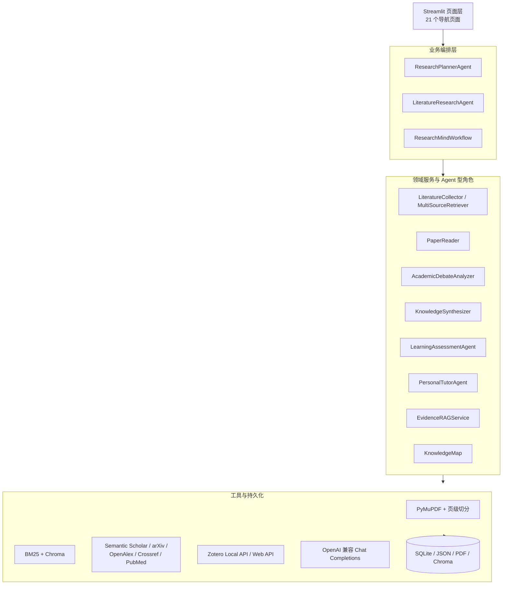
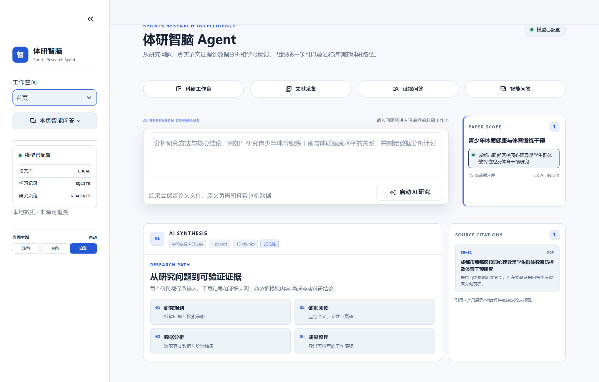
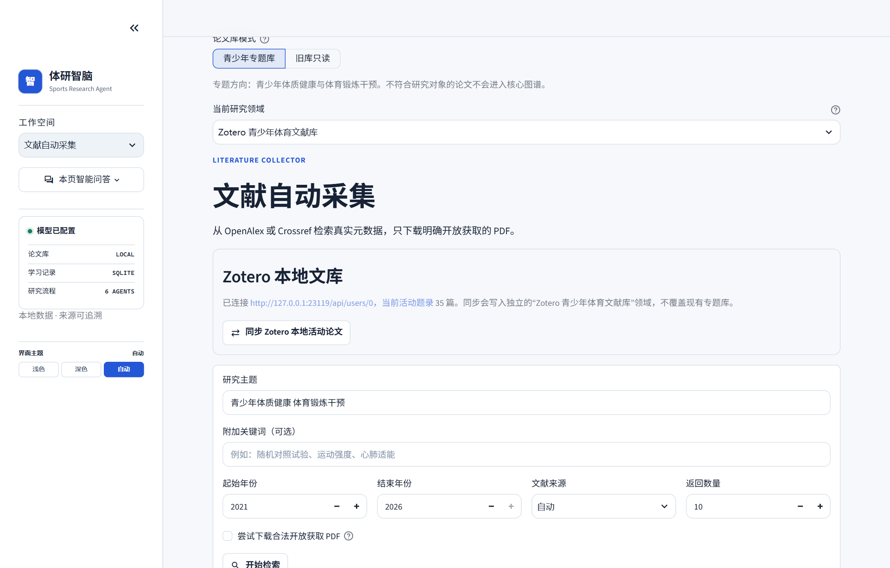
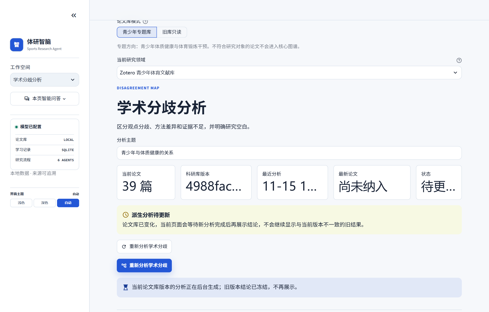
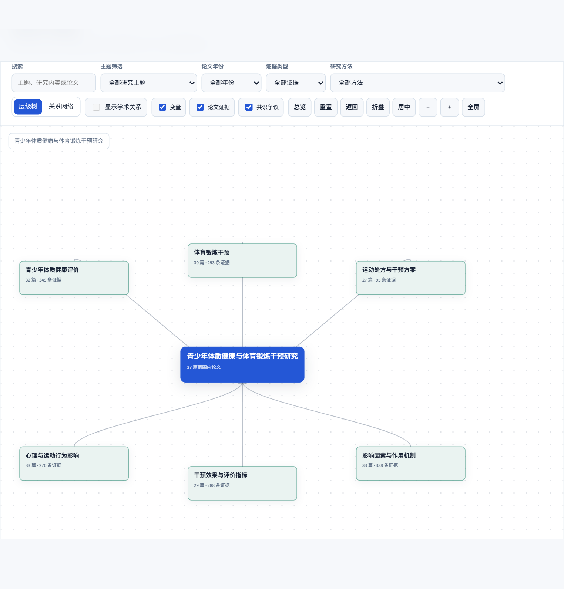
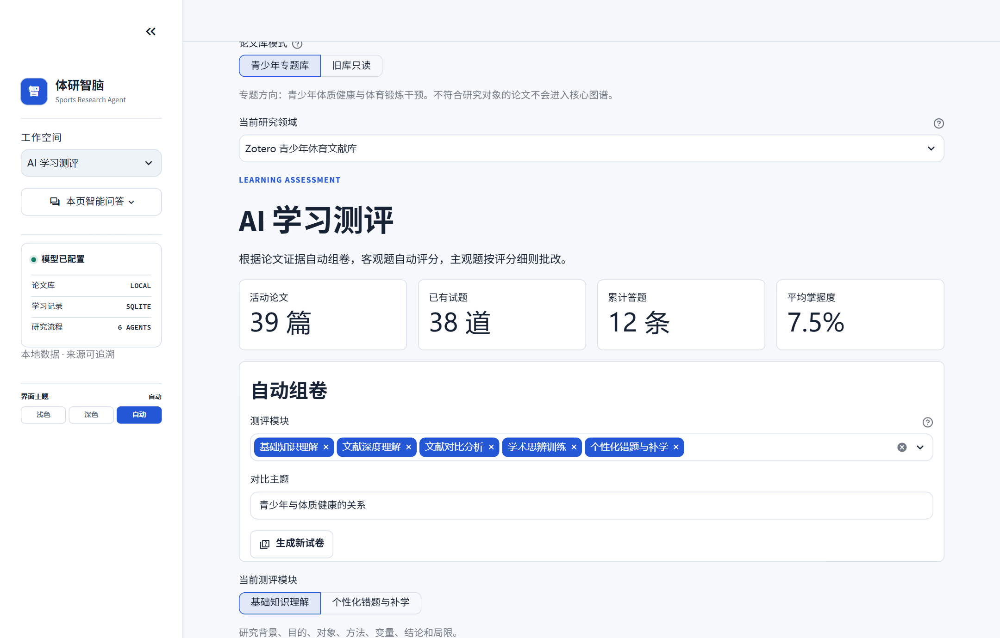
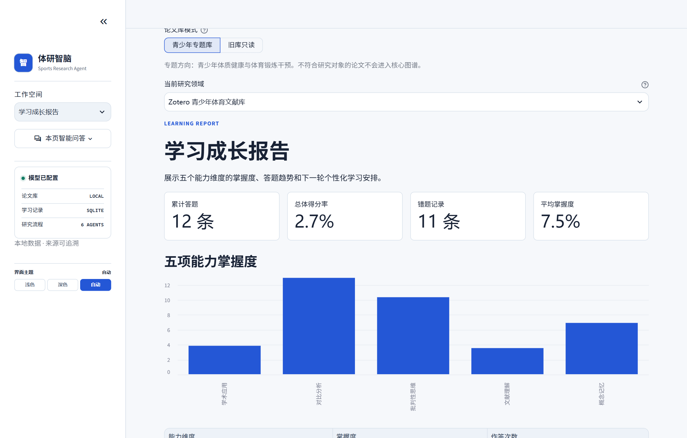

# 体研智脑 Agent

**基于大语言模型、多角色 Agent 编排与 RAG 的体育科研全流程智能助手**

面向青少年体质健康、体育锻炼干预、学校体育与运动心理研究，将真实文献采集、
PDF 页级证据、跨论文分析、学术争议、知识图谱、学习测评与复习反馈连接为一条
可检查的科研工作流。

> 2026 年第九届传智杯全国大学生数智创新与 AI 应用大赛
> AI 大模型创新应用挑战赛（个人赛、大模型应用赛道）

作者：刘轩
单位：四川工商学院

## 团队信息

- 参赛形式：个人赛（AI 大模型应用赛道）
- 项目负责人：刘轩
- 项目成员：刘轩
- 所属单位：四川工商学院
- 联系方式：按赛事报名表提交；公开代码仓库不展示个人邮箱和手机号
- 公开代码仓库：https://github.com/lion-siong/tiyan-zhinao-agent

## 项目状态

| 项目 | 当前实现 |
| --- | --- |
| 应用形态 | Python 3.11/3.12 + Streamlit 本机单用户应用 |
| 导航页面 | 21 个：核心科研区 10 个 + ResearchMind 11 个 |
| Agent 形态 | 规则角色 + 确定性顺序编排 + 局部大模型工具调用 |
| 公开检索 | Semantic Scholar → arXiv → OpenAlex → Crossref → PubMed |
| 本地检索 | BM25 + Chroma 语义检索 + 混合检索 |
| 持久化 | SQLite、JSON、PDF、Chroma 可重建索引 |
| 正式专题领域 | 44 篇论文、3,296 条页级证据；25 篇全文、16 篇摘要、3 篇仅题录 |
| 全 SQLite | 46 篇论文、3,311 条页级证据（含另一独立领域 2 篇、15 条证据） |
| 五层研究关系图 | 正式领域 138 个节点、1,220 条有来源关系；不等同论文引用网络 |
| 自动测试 | 181 passed，0 failed；最终导出副本需再次复测 |

系统不会把“搜索结果”直接当作“已读全文”，也不会把没有证据的模型输出包装成
科研结论。没有正文、没有命中证据、模型不可用或派生索引损坏时，界面会明确说明
当前模式和证据边界。

## 1. 项目背景

### 1.1 科研痛点

体育科研初学者通常同时面对四类问题：

1. 检索到的论文数量很多，但题录、摘要和全文状态混在一起。
2. 阅读 PDF 后，研究目的、对象、方法、结果、统计和局限难以逐篇结构化。
3. 多篇论文结论不一致时，容易把不同研究问题、不同结局或同一论文内部差异
   拼成“学术争议”。
4. 文献、知识图谱、测评和错题互不相连，无法形成学习闭环。

通用大模型可以生成流畅综述，却可能补造作者、DOI、页码、样本量和“研究普遍认为”
等无法核验的信息。项目因此以“证据可追溯”为第一约束。

### 1.2 项目目标

- 使用真实公开学术接口检索题录，不伪造论文。
- 将 PDF 按页切分为可定位证据，保留论文、文件、页码、原文和来源类型。
- 在同一个论文库上执行阅读、争议、综合、图谱、测评和辅导。
- 论文库变化后使旧分析失效，避免继续展示过期结论。
- 对模型、网络、向量库和文件异常提供明确降级路径。

### 1.3 目标用户

- 体育教育、运动训练和运动人体科学本科生与研究生。
- 需要整理青少年体质健康专题文献的教师和科研人员。
- 需要演示“大模型 + 工具 + RAG + 知识图谱 + 学习闭环”的竞赛团队。

## 2. 核心创新

### 2.1 多角色 Agent 编排

ResearchMindWorkflow 将六个职责组件按可检查顺序调用：

```text
文献采集 → 论文阅读 → 学术争议分析 → 知识综合
         → 学习测评 → 个性化辅导 → 下一轮阅读/检索
```

这六个职责组件共享同一个论文库和 `EvidenceRef` 证据模型。系统不使用 LangGraph，
也没有多个模型自由协商；这种设计换来了状态明确、可调试、可回退和可复现。

### 2.2 原文证据驱动的学术分歧

学术争议只在同一研究问题内比较论文级结果方向。只有同时存在正向结果与明确负向
结果时，才形成待审核候选。未达统计显著不能被解释为方向相反，因此单独记录，
不计入反方。版权、作者单位、许可声明和参考文献不会进入研究证据。

### 2.3 跨论文比较与综合

论文阅读提取目的、对象、方法、干预、对照、测量、结果、统计、结论和局限。
争议分析比较设计、样本、指标、方向与证据来源，知识综合再形成共识、分歧、
研究空白和证据确定性初筛。

### 2.4 Zotero 与专题知识库

Zotero Local API 同步当前活动条目、集合和 PDF 附件到独立领域，不修改 Zotero。
题录、页级证据、分析、题库和学习记录保存在独立专题 SQLite 与知识库路径。

### 2.5 学习测评闭环

学习测评包含 5 个模块、9 种注册题型、8 种五模块预置题型和 5 维评分：

1. 基础知识理解。
2. 文献深度理解。
3. 文献对比分析。
4. 学术思辨训练。
5. 个性化错题与补学。

评分记录更新五维“练习表现”、错题标签和推荐论文。没有记录的维度显示“未测”；
该指标尚未经过能力量表校准，不作为科研能力评级。

## 3. 技术架构



### 3.1 大语言模型

- 使用标准库调用 OpenAI 兼容 `/chat/completions` 接口。
- `LiteratureResearchAgent` 通过 Function Calling 选择公开检索工具。
- RAG 回答只接收检索得到的证据片段。
- 主观题评分按证据和五维细则返回结构化分数。
- 未配置模型时，普通问答使用明确标注的模拟模板；RAG 使用原文摘录。

### 3.2 RAG

- BM25：中文双字组合与英文连续词项。
- Chroma：`intfloat/multilingual-e5-small` 生成可重建语义索引。
- 混合模式融合关键词和语义候选；语义服务不可用时回退 BM25。
- 命中结果保留题名、文件名和页码；没有证据时拒绝生成结论。

### 3.3 数据持久化

- SQLite：领域、论文、证据、阅读分析、争议、题库、答题和掌握度。
- JSON：文献清单、页级证据、研究框架和可审计导出。
- Chroma：派生向量索引，可从证据文件重建。
- 论文库指纹：论文或证据发生变化后，旧派生分析标记为待更新。

## 4. Agent 真实能力与边界

| 检查项 | 当前实现 | 真实性说明 |
| --- | --- | --- |
| 任务规划 | `ResearchPlannerAgent` 规则拆解研究步骤 | 规则规划，不是大模型自主规划 |
| 工具调用 | Function Calling 选择 `semantic_scholar_search` | 真实接口，失败切规则检索 |
| 不同工作流 | 文献研究、工作台、ResearchMind、用户 PDF RAG | 由页面和任务入口选择 |
| RAG | BM25 + Chroma + 混合回退 | 已实现并有测试 |
| 原文溯源 | `EvidenceRef` 保存文件、页码和原文 | 已实现 |
| 多文比较 | 阅读、争议、对比题、知识图谱 | 已实现 |
| 共识与分歧 | 按 7 个研究问题做论文级方向归一 | 规则初筛，不是正式 GRADE |
| 状态和错误 | 分析状态、论文指纹、错误提示、回退 | 已实现 |
| 根据结果继续 | 错题和掌握度驱动下一轮题目；检索失败回退 | 部分动态，主流程仍为固定顺序 |
| 自主多 Agent | 无多个模型自由协商 | 不宣称 |

## 5. 功能模块

| 模块 | 输入 | 处理 | 输出 |
| --- | --- | --- | --- |
| 科研工作台 | 研究问题 | 规则规划、检索式、证据命中、阶段状态 | JSON 研究底稿 |
| 公开文献研究 | 研究问题、条数 | Function Calling、五源检索、去重、引用 | 题录、综述、来源报告 |
| Zotero 同步 | Local API 活动库 | 读取条目、集合、PDF 子附件 | 独立 Zotero 专题领域 |
| PDF 入库 | 用户 PDF 或开放 PDF | 哈希、书目、页级文本、切分、索引 | 论文、证据、框架 |
| 文献证据问答 | 问题、top-k | BM25/语义/混合检索 | 带文件名和页码的回答 |
| 论文智能阅读 | 当前论文库 | 十字段证据提取、质量过滤 | `PaperAnalysis` |
| 学术争议分析 | 多篇论文 | 同题方向比较、方法差异 | 共识、争议、未决问题 |
| 知识图谱 | 论文、分析、证据、综合 | 五层节点和关系 | 可交互科研图谱 |
| AI 学习测评 | 论文证据、错题、掌握度 | 五模块组卷 | 可追溯题目与评分 |
| 个性辅导 | 答题记录 | 五维掌握度、薄弱标签 | 论文推荐与下一轮试题 |
| 数据分析 | CSV/XLSX | 描述统计与直方图 | 表格和图表 |
| 论文删除/恢复 | 论文 ID | 软删除、备份、派生失效 | 可恢复或永久删除 |

## 6. Windows 安装

### 6.1 环境要求

- Windows 10/11。
- Python 3.11 或 3.12，当前验收版本为 3.12.16。
- 可选：Zotero Desktop 7/10 本地 API。
- 首次语义检索需要能下载 `multilingual-e5-small` 模型。

### 6.2 创建虚拟环境

```powershell
cd "<解压后的项目根目录>"
py -3.12 -m venv .venv
.\.venv\Scripts\python.exe -m pip install --upgrade pip
.\.venv\Scripts\python.exe -m pip install -r requirements.txt
```

文档与浏览器截图工具：

```powershell
.\.venv\Scripts\python.exe -m pip install -r requirements-dev.txt
```

### 6.3 配置环境变量

```powershell
Copy-Item .env.example .env
```

至少检查以下配置：

```dotenv
OPENAI_API_KEY=
OPENAI_BASE_URL=https://api.openai.com/v1
OPENAI_MODEL=gpt-4o-mini
RAG_RETRIEVAL_MODE=hybrid
```

真实密钥只写入本机 `.env`，不要提交、截图或发送到聊天工具。

### 6.4 Zotero Local API

1. 安装并运行 Zotero Desktop。
2. 启用 Local API，默认地址为 `http://127.0.0.1:23119/api/users/0`。
3. 在“文献自动采集”页面点击“同步 Zotero 本地活动论文”。
4. 同步写入独立领域，不修改 Zotero 数据库。

Web API 写入模块存在于 `researchmind/zotero_service.py`，但当前比赛主流程只把
Local API 读取/同步列为已验证功能。

## 7. 启动

```powershell
.\.venv\Scripts\python.exe -m streamlit run app.py
```

默认地址：`http://localhost:8501`。

数据库和目录在首次运行工作流时初始化；已有数据库会自动执行增量列迁移，不重建
或覆盖论文数据。

健康检查：

```powershell
Invoke-WebRequest -UseBasicParsing http://127.0.0.1:8501/_stcore/health
```

## 8. 测试

完整测试：

```powershell
$env:PYTHONUTF8="1"
.\.venv\Scripts\python.exe -m pytest -q
```

Windows 系统临时目录权限不足时：

```powershell
New-Item -ItemType Directory -Force C:\tmp\researchmind-tests
.\.venv\Scripts\python.exe -m pytest -q --basetemp C:\tmp\researchmind-tests
```

最近一次验收：

```text
181 passed, 7 warnings
```

当前测试覆盖文献接口、五源回退、PDF、证据、检索、删除、备份、争议、知识图谱、
学习测评、页面加载与安全审计。未覆盖 OCR、500 页以上 PDF、真实 Zotero Web
写入和外部服务长期稳定性。

## 9. 项目目录

```text
app.py                         Streamlit 主入口和核心页面
config.py                      环境变量、路径和超时配置
main.py                        命令行规划/选题/问答入口
agents/
  planner.py                   规则任务规划
  literature_research_agent.py Function Calling 文献 Agent
researchmind/
  workflow.py                  六阶段确定性工作流
  agents.py                    阅读、争议、综合、测评、辅导
  literature_retrieval.py      五类公开学术源编排、重试、去重
  literature_import.py         题录入库、回收站与永久删除
  zotero_local_service.py      Zotero Local API 同步
  storage.py                   SQLite 持久化
  knowledge_map*.py            五层知识图谱与页面
  ui.py                        ResearchMind 页面
services/
  llm_service.py               OpenAI 兼容接口与明确模拟模式
  rag_service.py               BM25/混合检索与证据回答
  vector_service.py            Chroma 与 HNSW 恢复
  user_paper_rag.py            用户 PDF 隔离 RAG
tools/
  pdf_reader.py                PyMuPDF 文本提取
  pdf_metadata.py              书目识别
  document_chunker.py          页内证据切分
  library_ingest.py            PDF 入库与回滚
  knowledge_base.py            清单与证据索引
  data_analysis.py             CSV/XLSX 分析
  security_audit.py            敏感文件与导出审计
tests/
docs/
demo/
```

## 10. 功能演示截图

### 首页



展示科研流程入口、当前论文库和模型状态。

### 文献自动采集



展示 Zotero 本地同步、五类公开检索来源和开放 PDF 开关。

### 学术分歧分析



展示论文库版本、分析状态、共识与争议入口。

### 五层知识图谱



展示领域、主题、研究方向/变量、论文证据和学术综合之间的证据关系。

### AI 学习测评



展示五模块组卷、答题、证据展开、五维评分和下一轮补学。

### 学习成长报告



展示已测维度的练习表现、历史趋势、错题和推荐论文；未测维度显示“未测”。

完整竞赛技术文档和更多证据见
[`docs/technical_document/`](docs/technical_document/)。

## 11. 工程与安全

生成不含本地密钥、数据库和论文 PDF 的提交暂存目录：

```powershell
.\.venv\Scripts\python.exe -m tools.prepare_submission `
  --output .\build\competition-source-20261116
```

```powershell
.\.venv\Scripts\python.exe -m tools.security_audit `
  .\build\competition-source-20261116 --json
```

审计会阻断 `.env`、数据库、日志、私钥和浏览器资料，并提示 PDF、Chroma 和论文
正文需要版权复核。正式提交时应只打包经过筛选的源代码、文档和许可允许的资产，
不要直接压缩整个工作区。

## 12. 已知限制

- 不支持扫描版 PDF OCR。
- 500 页以上 PDF 尚未完成真实样本验收。
- 复杂表格、公式、双栏和图片文字可能提取不完整。
- 自动争议是规则初筛，不是正式 PRISMA 系统综述或 GRADE 专家评价。
- 当前只保存最近一次分析状态，没有完整历史任务追踪系统。
- 当前无账号、租户隔离、权限、限流和公网部署保障。
- 外部学术接口、嵌入模型和 LLM 依赖网络稳定性。
- 只有题录/摘要的论文不能进入全文结论。

## 13. 后续计划

- 增加 OCR、版面分析和表格/公式保留。
- 完成 500 页以上长文档与跨版本去重测试。
- 将方向、变量和关系物化为派生表，支持更大知识库。
- 增加完整任务事件日志、可观测性和人工复核界面。
- 增加正式 GRADE 偏倚风险量表和专家一致性评价流程。
- 在受控部署下增加账号、权限、限流与审计。

## 14. 文档

- [技术架构说明](docs/ARCHITECTURE.md)
- [部署说明](docs/DEPLOYMENT.md)
- [API 与核心接口](docs/API.md)
- [功能说明](docs/FUNCTIONALITY.md)
- [代码库审查报告](docs/CODEBASE_AUDIT_REPORT.md)
- [最终验收报告](docs/FINAL_ACCEPTANCE_REPORT.md)
- [比赛提交检查清单](docs/COMPETITION_SUBMISSION_CHECKLIST.md)
- [开发过程、Prompt 与历史评审材料](docs/history/README.md)
- [演示说明](demo/README.md)
- [安全、隐私与导出规范](docs/SECURITY_AND_PRIVACY.md)
- [竞赛技术文档](docs/technical_document/体研智脑Agent_技术文档.pdf)

## License

本项目源代码仅用于竞赛评审、学术评价和非商业演示。论文 PDF、数据库、用户学习
记录及第三方材料不随源代码授权。详见 `LICENSE`。
