# 体研智脑 Agent

## 基于大语言模型与智能体协作的体育科研全流程智能助手

**2026 年第九届传智杯全国大学生数智创新与 AI 应用大赛**

**AI 大模型创新应用挑战赛（个人赛、大模型应用赛道）**

**技术文档**

作者：刘轩  
单位：四川工商学院  
日期：2026 年 11 月

<!-- PAGEBREAK -->

## 摘要

体育科研初学者面对的核心困难，通常不是缺少一个生成文本的输入框，而是难以把研究问题、真实文献、研究方法、原文证据、学术判断和学习训练连接成可检查的流程。普通文献管理工具偏重收藏与检索，通用大模型又可能生成无法回到论文页码的结论。针对这一矛盾，本项目构建了“体研智脑 Agent”：一个面向青少年体质健康与体育锻炼研究场景的本地科研辅助系统。

系统以 Streamlit 提供 21 个功能页面，使用 Python 规则、SQLite、JSON、PyMuPDF、BM25、Chroma 和 OpenAI 兼容接口组成分层架构。多源检索编排支持 Semantic Scholar、arXiv、OpenAlex、Crossref 和 PubMed，并支持 Zotero Local API 本地同步；论文进入系统后，按照页切分原文并保留题名、文件、页码和来源类型。EvidenceRAGService 通过 BM25 与语义检索的融合完成证据问答，在没有证据时拒绝生成结论。ResearchMindWorkflow 以显式顺序编排论文阅读、同题争议分析、知识综合、五模块学习测评与个性化辅导，并通过论文库指纹识别数据变化。知识图谱采用五层结构，将核心领域、研究主题、研究方向与变量、论文证据、共识争议和研究空白分层组织。

项目当前的主导形态是“规则角色 + 确定性编排 + 局部大模型工具调用”，而不是多个大模型自主协商。Function Calling 用于公开文献检索，证据约束提示用于 RAG 问答，大模型还可按五维细则批改主观题；模型不可用时系统会明确降级，不把模板结果伪装成模型输出。本轮实时数据库中有 44 篇活动论文和 3,296 条页级证据，其中 25 篇有全文证据、16 篇进行摘要级分析、3 篇仅有题录。`evidence-synthesis-v5` 从 7 个研究问题形成 2 个初步共识、5 个“一致未观察到显著差异”、0 个自动争议候选；未达统计显著不再被解释为方向相反。当前图谱包含 138 个节点和 1,220 条有来源关系。完整自动化测试结果为 181 项通过。

**关键词：** 体育科研；大语言模型；Function Calling；检索增强生成；证据溯源；知识图谱；智能测评

**本版关键核验口径**

| 核验项 | 当前值 | 证据来源 |
| --- | ---: | --- |
| 正式领域论文/证据 | 44 篇 / 3,296 条 | `papers-44.csv`、`evidence-3296-core-domain.csv` |
| 全库论文/证据 | 46 篇 / 3,311 条 | `papers-46-all-database.csv`、`evidence-3311-all-database.csv` |
| 研究关系图 | 138 节点 / 1,220 条关系 | `knowledge-graph-statistics.json` |
| 当前源码测试 | 181 passed | `pytest-v5-verbose.txt`、`pytest-v5-results.xml` |

本版把“流程执行成功”“数据统计一致”“科研判断正确”分成三个层级。自动测试通过、节点和关系数量可复算，只能证明工程链路和真实数据读取成立；研究结论是否成立仍以原文证据、研究可比性和领域教师复核为准。文中所有限制均保留，不把计划能力写成已完成能力。

<!-- PAGEBREAK -->

## 目录

目录由 PDF 排版引擎根据正文标题和实际页码自动生成。

<!-- TOC -->

**阅读提示**

- 第 3～4 章回答“模型理解什么、规则约束什么、证据如何回指论文”。
- 第 6 章集中给出当前测试、数据口径、对照实验和未覆盖场景。
- 文中“Agent 型角色”是职责组件，不代表多个大模型自主协商。

**优先复核入口**

1. 六模块覆盖边界：`赛题覆盖表_v5.md`。
2. 原始测试记录：`evidence/tests/pytest-v5-verbose.txt` 与 JUnit XML。
3. 论文、证据和图谱导出：`evidence/exports/`。
4. 七题对照复判：`evidence/controversy-comparison/REPORT_V5.md`。
5. 本轮整改轨迹：`第二轮整改记录_v5.md`。

<!-- PAGEBREAK -->

# 第一章 项目概述

## 1.1 体育科研领域的实际痛点

青少年体质健康、体育锻炼、学校体育干预和心理健康是体育教育研究中的高频方向，但相关研究在对象年龄、运动剂量、干预周期、结局指标和统计方法上差异很大。研究者需要在大量中英文论文中完成检索、筛选、阅读、比较和引用。对于本科生和科研初学者，最容易出现的问题不是“完全没有资料”，而是资料、证据和结论之间失去可核验联系。

| 常见环节 | 实际困难 | 直接风险 |
| --- | --- | --- |
| 选题 | 研究主题、对象、变量和结局指标混在一起 | 题目宏大但无法实施 |
| 检索 | 只看到题录或摘要，却误认为已经读过全文 | 综述基础不牢 |
| 阅读 | 研究方法、样本、结果和局限散落在不同页面 | 结论超出原文范围 |
| 多篇比较 | 不同主题、不同设计的结果被强行合并 | 制造伪共识或伪争议 |
| 写作 | 生成文本缺少可定位引用 | 无法核验，存在幻觉风险 |
| 学习 | 错题、薄弱点和后续阅读互不关联 | 训练无法形成闭环 |

## 1.2 传统文献管理与阅读工具的局限

传统工具通常解决“文件放在哪里”和“全文是否可搜”两个问题，却不直接回答“这篇论文怎样支持某个结论”。即使具备标签和笔记，研究结论仍需要人工判断证据方向，并区分相关关系、因果推断与研究局限。通用大模型可以总结摘要，但如果没有严格证据上下文，容易补造样本量、页码、DOI 或“研究普遍认为”等表述。项目因此把设计目标从“生成流畅答案”改为“让判断能够回到证据”。

## 1.3 大模型的应用机会与边界

大模型适合承担工具选择、检索式整理、受限证据综合和开放式主观题评分，但不应成为事实源。本项目把模型放在三个受控位置：在 LiteratureResearchAgent 中通过 Function Calling 选择真实学术检索工具；在 EvidenceRAGService 中只读取检索得到的证据片段；在 LearningAssessmentAgent 中按照题目证据和五维细则评分。元数据、页级证据、论文方向、共识与争议、题库和学习记录分别持久化，模型失败时保留可解释的规则路径。

场景依据方面，体育教育嵌入体能干预、学校运动干预网络 Meta 分析、青年运动参与健康结局、学校 HIIT 随机对照试验和青少年运动与抑郁焦虑伞式综述分别提供了体育教育、体质健康、运动干预和心理健康研究的真实文献背景[11-15]。证据组织参考 PRISMA 2020 报告规范[16]，证据确定性讨论参考 GRADE 框架[17]；但系统当前只做自动初筛，不冒充正式 PRISMA 系统综述或 GRADE 专家评价。

## 1.4 项目目标

本项目面向青少年体质健康与体育锻炼方向，形成六个可验证目标：

1. 将研究问题拆成研究设计、检索策略和阶段状态，而不是直接生成论文。
2. 只从公开学术接口读取真实题录，并把题录、摘要和全文证据区分开。
3. 使用页级 `EvidenceRef` 保存论文、文件、页码、原文、来源类型和段落提示。
4. 通过 BM25、语义检索和混合检索为问答与科研分析提供证据。
5. 以具体研究问题为单位形成共识、争议、研究空白和证据确定性初筛。
6. 将论文证据用于组卷、评分、错题、练习表现和下一轮学习建议。

## 1.5 应用场景与价值

系统适用于体育教育本科生文献综述训练、教师科研选题准备、研究生文献初筛、课程知识测验和竞赛演示。其主要价值不在于替代研究者，而在于把“检索到论文”“读过论文”“形成结论”和“支持教学训练”拆成可复核阶段。系统对无全文、无摘要、无证据和无模型配置的情况均保留明确状态，适合作为科研方法教学中的证据意识训练工具。

## 1.6 真实功能状态清单

| 能力 | 状态 | 代码或运行依据 | 说明 |
| --- | --- | --- | --- |
| 真实题录检索 | 已实现 | `literature_retrieval.py`、`LiteratureResearchAgent` | Semantic Scholar、arXiv、OpenAlex、Crossref、PubMed |
| Zotero 本地读取 | 已实现 | `zotero_local_service.py` | 读取活动条目、集合和 PDF，不修改 Zotero |
| Zotero Web 写入 | 部分实现 | `zotero_service.py` | 具备条目与附件 API，未作为本次运行验收主路径 |
| PDF 页级证据 | 已实现 | PyMuPDF、`document_chunker.py` | 保存文件名、页码和原文 |
| 混合检索 RAG | 已实现 | `rag_service.py`、`vector_service.py` | BM25、Chroma 与失败回退 |
| 学术争议分析 | 已实现，规则初筛 | `AcademicDebateAnalyzer` | 仅正向对明确负向形成待审核候选；未达显著不列反方 |
| 五层知识图谱 | 已实现 | `knowledge_map.py`、CCv2 组件 | 138 节点、1,220 条有来源关系；不等同论文引用网络 |
| 五模块学习测评 | 已实现 | `LearningAssessmentAgent` | 客观题与五维主观题评分 |
| 错题与成长报告 | 部分实现 | `PersonalTutorAgent`、学习页面 | 已测维度显示练习表现；未测显示“未测”，不作能力量表结论 |
| OCR | 未实现 | PDF 页面明确提示 | 扫描版不能建立文字索引 |
| 自主多 Agent 协商 | 未采用 | `ResearchMindWorkflow` | 当前为确定性顺序编排 |
| 多租户与权限 | 未实现 | 当前单机架构 | 不作为生产级多用户平台 |

**状态判定规则**

| 状态 | 判定标准 |
| --- | --- |
| 已实现 | 有真实代码入口、持久化结果和自动化或运行证据 |
| 部分实现 | 主路径可运行，但关键子能力或验收场景仍缺失 |
| 未实现 | 当前代码没有可用的完整入口，页面明确提示边界 |
| 未采用 | 架构上主动不采用，不在演示中伪装成已启用 |

## 1.7 官方六模块覆盖与边界

| 官方模块 | 当前判定 | 已有入口与证据 | 尚未满足 |
| --- | --- | --- | --- |
| PDF 管理与细粒度解析 | 部分通过 | PyMuPDF 页级文本、EvidenceRef、论文/证据导入测试 | OCR、正文语义版本去重、标题树、表格公式、541 页样例未验收 |
| 抗幻觉问答与多文推理 | 部分通过 | BM25/Chroma 检索、无证据拒答、页级引用、多文对比 | 逐论断“原文支持关系”和可靠的多文自动推断仍需人工复核 |
| 版式阅读与联动翻译 | 未通过 | 当前主路径只有可复制文本提取 | 双向引文跳转、中英对照和同步滚动未实现 |
| 自动检索、追踪与推荐 | 部分通过 | 五源检索、Zotero 同步、专题相关度预检 | 持续追踪、增量更新、由代码和学习反馈共同驱动的推荐未完成 |
| 引用图谱与综述探索 | 部分通过 | 138 节点/1,220 条研究关系图、综述底稿 | 当前图不等同论文引用网络；核心论文算法与 Future Work 时效核查缺失 |
| 写作与可视化 Copilot | 部分通过 | GB/T 引用格式化、CSV 描述统计和图表、研究框架 | 完整 References 写作框架、可复用绘图脚本、学术图注与英译未完成 |

这张表是提交前验收口径。已存在代码和研究关系图不直接等同于官方模块“通过”；只有入口、真实输入输出、运行证据和限制同时可核验时，才标为“通过”。

<!-- CONTINUE -->

# 第二章 需求分析与系统总体设计

## 2.1 用户需求分析

目标用户包括体育教育专业学生、体育教师、科研初学者和需要快速整理专题文献的研究人员。用户需要本机运行、无需复杂部署、能够上传或同步真实 PDF、看到引用页码、区分网络依赖失败，并在学习后获得可执行复习建议。

## 2.2 功能需求

| 需求类别 | 具体要求 | 当前状态 |
| --- | --- | --- |
| 文献检索 | 五类公开来源编排、失败隔离与回退 | 已实现 |
| Zotero | 读取 Local API 活动论文和 PDF，同步到独立领域 | 已实现；Live 写入未作为当前主流程 |
| PDF 处理 | 校验、书目识别、页级文本、证据切分 | 已实现；不含 OCR |
| 证据问答 | BM25、语义、混合检索和多篇论文溯源 | 已实现 |
| 学术分析 | 阅读、同题争议、共识、证据确定性初筛 | 已实现，属于自动化初筛 |
| 知识图谱 | 五层节点、关系网络、筛选与详情面板 | 已实现 |
| 学习测评 | 五模块、客观题、主观题细则、错题和成长报告 | 已实现 |
| 数据维护 | 去重、软删除、恢复、永久删除、备份和版本失效 | 已实现 |

## 2.3 非功能需求

系统优先保证可追溯性、可恢复性与本地可运行性。网络接口失败时不能破坏本地数据；论文或证据变化后，旧分析不能继续作为当前结论展示；模型未配置时要明确标注模拟或摘录结果；数据库和知识库路径必须隔离；日志与界面不能显示 API Key。当前版本定位为本机单用户应用，不以多租户生产系统为目标。

## 2.4 系统总体架构

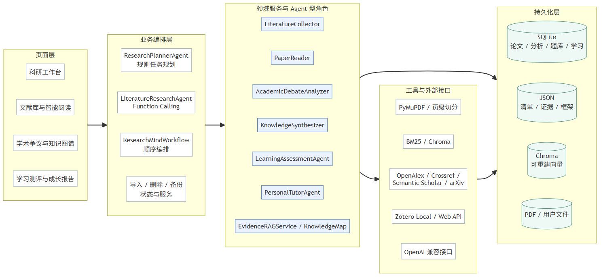

图 1 中的“Agent 型角色”表示承担明确科研职责、具有独立输入输出和失败边界的领域组件。它们由 ResearchMindWorkflow 顺序调用，不是多个模型自由对话。页面层只负责交互和状态展示，检索、分析、证据选择与持久化分别由业务层、领域层和工具层完成。

## 2.5 前后端与核心技术栈

| 层次 | 技术 | 真实用途 |
| --- | --- | --- |
| 前端 | Streamlit 1.66.1 | 页面导航、表单、表格、图表和状态反馈 |
| 语言 | Python 3.12.16 | 业务逻辑、工具调用和服务编排 |
| PDF | PyMuPDF 1.28.2 | 页级文本提取与文件校验 |
| 关键词检索 | 自实现 BM25 | 中文双字与英文词项检索 |
| 语义检索 | Chroma 1.5.9 + multilingual-e5-small | 可重建向量索引与相似度检索 |
| 关系数据 | SQLite | 论文、证据、分析、题库和学习状态 |
| 证据文件 | JSON | 清单、页级证据和研究框架 |
| 模型接口 | OpenAI 兼容 Chat Completions | Function Calling、RAG 和主观题评分 |

## 2.6 数据存储与数据流转

SQLite 保存当前研究状态，JSON 保存可审计的页面证据与分析底稿，Chroma 只保存可重建的派生向量。PDF 是原文文件，不由向量库反向生成。系统以论文元数据和证据生成 SHA-256 论文库指纹；论文新增、删除、恢复、元数据变化或分析引擎升级后，旧图谱和分析状态会被标记为待更新。

不同事实源承担不同职责：PDF 保存原始版面，JSON 保存可移植的页级证据，SQLite 保存关系状态和版本指纹，Chroma 只是可删除重建的检索索引。用户删除论文时，业务层同步失效关联题目和分析；向量索引损坏时，不使用旧缓存补写结论，而是回到原文或明确提示重建。

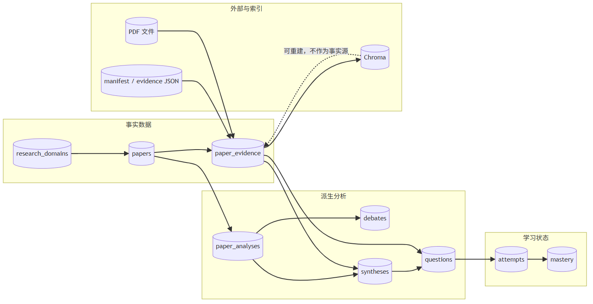

## 2.7 页面与自动化验收口径

项目的 `PAGES` 共包含 21 个可导航页面，其中核心科研区 10 个，ResearchMind 区 11 个。自动测试并非集中在一个用例中遍历全部 21 页：`test_basic.py` 的基础页面循环覆盖 8 个核心页，`test_workbench.py` 和 `test_literature_research.py` 分别覆盖科研工作台与智能文献研究，`test_researchmind.py` 遍历全部 11 个 ResearchMind 页面。因此 21 是全部页面口径，页面级 AppTest 覆盖分散在多个测试文件中。

现有 `capture-report.json` 中的 10 个页面仅指浏览器截图证据集，不是全部页面数量，也不是唯一的自动化测试范围。另有三张运行证据截图分别记录调度状态、模型调用和故障回退，其中后两张来自同一“智能文献研究”页面的不同运行条件。

<!-- CONTINUE -->

# 第三章 Agent 核心架构与工作流

## 3.1 整体运行机制

项目包含两种 Agent 使用方式。第一种是 LiteratureResearchAgent 的大模型工具调用：模型根据研究问题生成 `semantic_scholar_search(query, limit)` 调用，系统执行真实检索，再把工具结果回传给模型整理综述。第二种是 ResearchMindWorkflow 的确定性阶段编排：文献采集、论文阅读、争议分析、知识综合、学习测评和辅导按固定顺序执行，每一步都有独立数据结构和失败状态。

这种设计避免把普通函数调用包装成“多智能体自治”。规则规划器 ResearchPlannerAgent 当前只生成任务步骤、工具路线和选题模板；真正的文献研究、证据问答和主观题评分才会在配置可用时调用模型。

| 模型调用点 | 模型输入 | 规则层约束 | 已实现输出校验 | 失败降级 |
| --- | --- | --- | --- | --- |
| Function Calling 文献检索 | 研究问题、工具 schema | 只允许 `semantic_scholar_search`；条数有界 | 校验工具名、参数类型与公开来源返回结构 | 规则查询 + 多源检索；无结果不生成引用 |
| 证据约束 RAG | 检索片段及证据编号 | 只能用本次上下文；无命中先拒答 | 当前校验检索证据非空和回答调用状态；逐句引用支持关系尚未自动验证 | BM25 回退；模型失败显示证据摘录或错误 |
| 主观题评分 | 题目、标准答案、原文证据、五维细则 | 总分上限、维度分值、引用边界 | JSON 解析、分数范围与维度结构校验 | 回退本地可解释细则 |

“模型是否引用了正确证据”不能只靠提示词。当前 Function Calling 与对照实验脚本可以校验论文 ID/证据编号是否属于输入；RAG 回答的逐论断支持关系仍缺少自动引用校验器，文档将其列为未完成能力，不把“编号属于上下文”写成“原文支持论断”。

## 3.2 任务规划与工具交互

| 规划阶段 | 核心任务 | 输入 | 处理技术 | 输出 | 对应模块 |
| --- | --- | --- | --- | --- | --- |
| 采集 | 获取真实题录与开放 PDF | 主题、年份、来源 | 五源检索编排、下载校验 | CandidatePaper | `researchmind/literature_retrieval.py` |
| 导入 | 去重、保存、建立证据 | PDF 或题录 | SHA-256、PyMuPDF、页级切分 | PaperRecord、EvidenceRef | `tools/library_ingest.py` |
| 阅读 | 提取研究结构 | 页级证据或摘要 | 规则证据选择、来源质量过滤 | PaperAnalysis | `PaperReader` |
| 争议 | 同一问题内比较方向 | 多篇 PaperAnalysis | 正向/负向/无显著分流、样本和设计差异 | 待审核 ResearchConflict 候选 | `AcademicDebateAnalyzer` |
| 综合 | 共识、分歧、空白 | 阅读与争议结果 | 论文级聚合、确定性初筛 | DebateAnalysis / Synthesis | `KnowledgeSynthesizer` |
| 测评 | 组卷、评分和补学 | 证据、练习表现、错题 | 证据选项、五维评分 | AssessmentQuestion | `LearningAssessmentAgent` |
| 辅导 | 推荐与下一轮计划 | 答题记录、已测表现 | 得分率均值、论文匹配 | StudyRecommendation | `PersonalTutorAgent` |

## 3.3 核心工作流

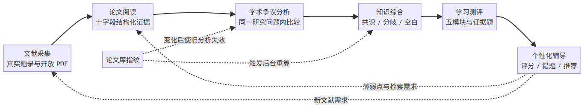

工作流以论文证据为共同输入。个性化辅导产生的薄弱标签和新文献需求通过重新检索、重新阅读与重新分析进入下一轮。论文库指纹变化后，旧学术分析不再被当作当前结果展示，后台最多使用两个工作线程执行重算。

## 3.4 文献采集、阅读与综合的协作

文献采集只负责真实元数据和明确开放 PDF；论文阅读只从当前活动论文的正文或摘要选择证据；争议分析把同一论文的多个片段归一为论文级方向；知识综合再按研究问题聚合。每个阶段保存独立记录，因此可以检查“论文是否存在”“是否解析”“分析是否与当前版本一致”，不会用一个页面数字代替整条数据链路。

## 3.5 异常处理与任务恢复

底层 `MultiSourceRetriever` 固定按 Semantic Scholar → arXiv → OpenAlex → Crossref → PubMed 执行五源聚合：单源失败被隔离，其他来源继续，报告保留来源状态、耗时和重试信息。该五源编排只接入“智能文献研究”页。另一个“文献自动采集”页使用较简单的 `LiteratureCollector`：默认先查 OpenAlex，OpenAlex 失败后才回退 Crossref；只有该页面自己的来源选择器允许指定 OpenAlex 或 Crossref。两个入口只在候选题录、开放 PDF 与页级证据处理阶段汇合，不能把其中一个页面的来源能力写成另一个页面的运行事实。

系统采用分层异常转换。外部 HTTP 错误被转换为中文可展示错误；Function Calling 失败时“智能文献研究”页仍调用其已配置的多源规则检索；429/403/5xx 由底层适配器按来源隔离；向量检索失败时回退 BM25；模型主观题评分失败时回退本地细则。分析任务在 SQLite 中记录 `分析中`、`已更新`、`待更新` 或 `失败`，失败原因保留在状态中。PDF 导入先准备文件，失败时恢复清单、证据索引和框架，避免留下半完成状态。

## 3.6 学习测评与个性化反馈

学习测评从真实论文证据生成基础知识、深度理解、文献对比、学术思辨和个性化补学五类内容。客观题由标准选项自动判分；主观题按“核心观点、证据引用、对比、逻辑、批判性”五维评分。PersonalTutorAgent 按已记录题目的得分率计算五维“练习表现”，没有记录的维度显示“未测”，不再使用未校准初值推断能力等级或薄弱项。下一轮组卷读取近期错题标签和已测低分维度，完成“学习 - 答题 - 评分 - 补学”的扩展闭环。

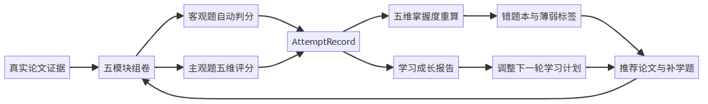

<!-- CONTINUE -->

# 第四章 核心技术与功能实现

## 4.1 文献自动采集与导入

**功能目标：** 从公开学术接口获得真实题录，并在确有开放获取地址时下载 PDF。

**实现原理：** 本项目存在两条不同来源链路。“文献自动采集”页调用 `LiteratureCollector`，默认使用 OpenAlex，失败时回退 Crossref；“智能文献研究”页通过 Function Calling 选择 `semantic_scholar_search` 工具入口，实际底层注入 `MultiSourceRetriever`，按 Semantic Scholar → arXiv → OpenAlex → Crossref → PubMed 汇总公开题录。单源失败不会中断五源任务，报告保留各源状态、耗时、重试和失败建议。这样设计的原因是保留原有自动采集页的可解释两源行为，同时让 Agent 研究页具备跨源聚合能力；两者不能混写为同一检索引擎。

**执行流程：**

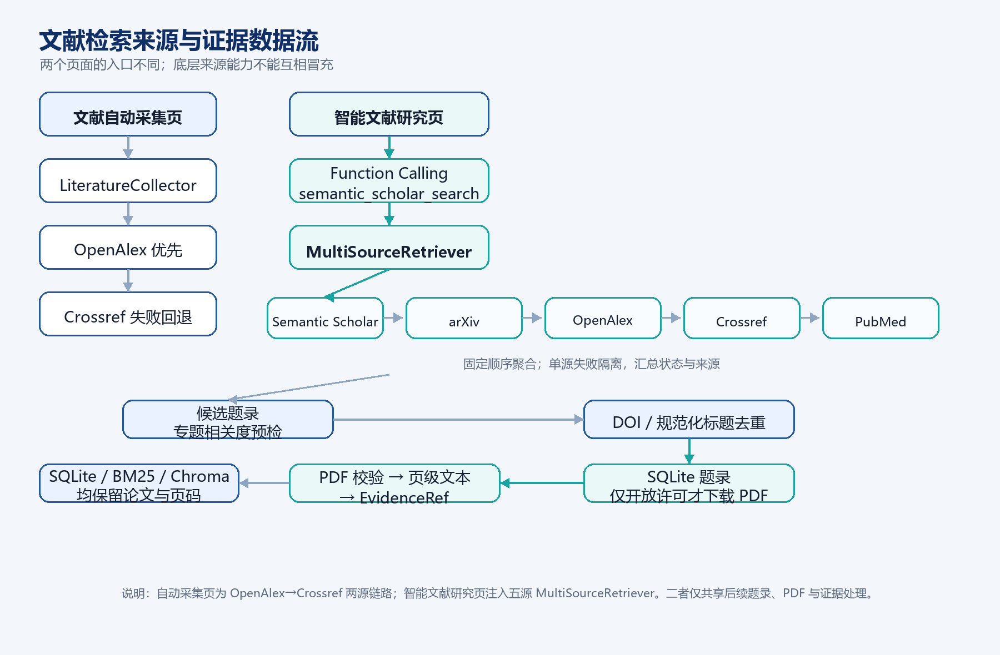

**输入与输出：** 输入为主题、时间范围、来源和条数；输出为 CandidatePaper，包括题名、作者、年份、期刊、DOI、摘要、关键词、来源和开放 PDF 地址。

**关键代码：** `researchmind/collectors.py::LiteratureCollector`、`researchmind/literature_research_ui.py::get_multi_source_retriever()`、`researchmind/literature_retrieval.py::MultiSourceRetriever`、`agents/literature_research_agent.py::LiteratureResearchAgent`。

**异常处理：** 空主题和越界条数直接拒绝；外部 HTTP、超时和结构异常转中文错误；Crossref 内容链接不会自动标记为开放许可。

## 4.2 Zotero 集成与论文管理

Zotero Local API 同步读取 `items/top`、集合和 PDF 子附件，并写入独立领域“Zotero 青少年体育文献库”。本轮实时活动库包含 44 篇论文，来源计数为 Zotero Local API 35 篇、Crossref 4 篇、OpenAlex 4 篇、项目内置真实论文清单 1 篇。来源计数来自数据库导出，不用旧文档的 39 篇历史快照反推。同步服务不会修改 Zotero 活动库。Web API 模块具备条目与附件创建能力，但本次文档只把当前已验证的 Local API 读取/同步链路列为运行主路径。

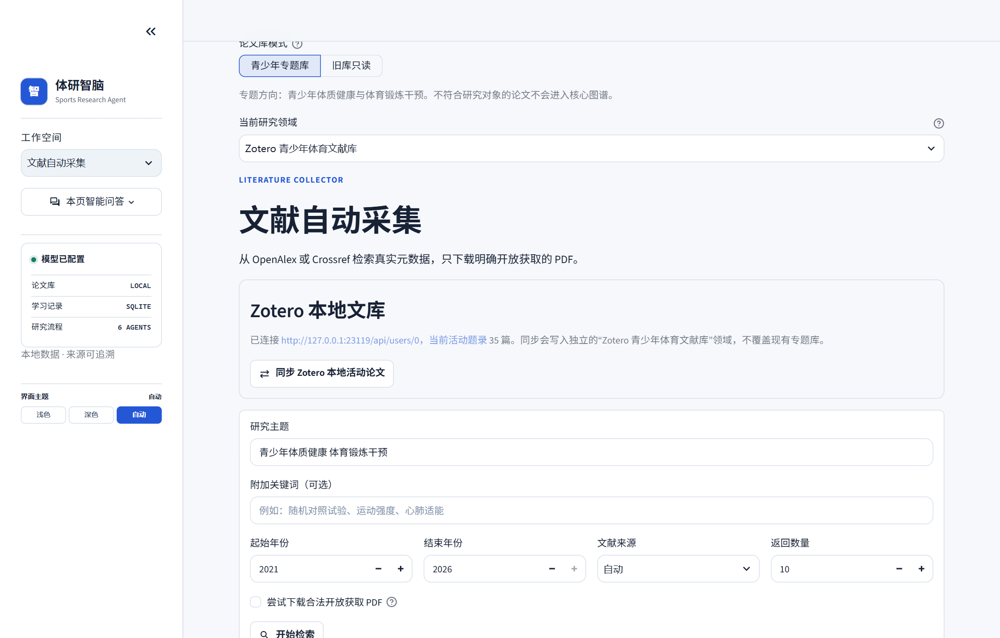

论文管理支持按 DOI 和规范化标题去重，只有补齐空字段时才合并已有元数据。软删除会隐藏论文并失效相关分析、题目和答题记录；恢复不会自动把旧派生结果重新标为有效；永久删除要求先进入回收站并生成备份。

## 4.3 PDF 解析与结构化提取

PDF 导入先计算 SHA-256，检查文件大小、扩展名、损坏和加密状态，再用 PyMuPDF 逐页提取可复制文本。片段不跨页，因此每条 EvidenceRef 都能回到具体文件与页码。通用页面阅读默认最多 80 页、40,000 字符；批量入库函数允许最多 10,000,000 字符，Zotero 本地同步单篇最多读取 300 页和 1,000,000 字符。

PaperReader 对目的、对象、方法、干预措施、对照条件、测量指标、结果、统计结果、结论和局限十个字段选择可定位证据。全文优先，缺失字段可由真实摘要补充；如果只有题录或评论性摘要，则标记证据不足。版权、作者单位、许可声明、参考文献和致谢通过 `evidence_quality.py` 排除出研究证据。

**输入与输出：** 输入为 PaperRecord 与 EvidenceRef；输出为带来源字段的 PaperAnalysis。

**关键代码：** `tools/pdf_reader.py`、`tools/document_chunker.py`、`researchmind/agents.py::PaperReader`、`researchmind/evidence_quality.py`。

**异常处理：** 空文件、损坏、加密、扫描版和超限文本均返回明确状态，不以模拟文本替代。

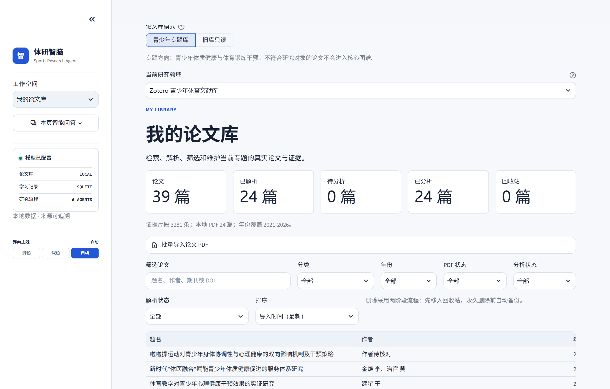

## 4.4 原文证据与抗幻觉问答

EvidenceRAGService 将 BM25 与 Chroma 语义检索结果融合。BM25 使用中文双字组合和英文连续词项；混合检索的基础公式为：

`final_score = 0.45 × normalized_bm25 + 0.55 × semantic_similarity`

检索结果包含来源模式、论文题名、文件名、页码、原文和相似度。若配置模型，系统把“唯一允许使用的证据片段”写入系统提示，要求关键结论标注证据编号；若模型不可用，则只展示带来源的原文摘录。没有任何命中证据时返回“当前文献不足以支持结论”。

**输入与输出：** 输入为研究问题和前 k 条片段；输出为 EvidenceAnswer、证据列表与检索模式。

**关键代码：** `services/rag_service.py`、`services/vector_service.py`、`services/prompt_service.py`。

**异常处理：** 向量模型不可用时回退 BM25；无证据、检索错误、模型失败和返回格式错误分别提示。

| 问答路径 | 当前行为 | 输出标记 |
| --- | --- | --- |
| 本地摘录 | 不调用模型，只展示检索到的原文 | `证据摘录（模拟）` |
| 证据约束模型回答 | 模型只能读取本次证据上下文，并标注证据编号 | `大模型回答` |
| 证据不足 | 不调用模型，不补写结论 | `证据不足` |

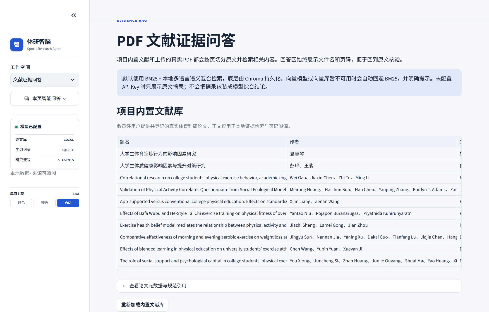

## 4.5 多篇论文的学术争议分析

争议分析首先按 7 个预设研究问题匹配论文，再分别记录正向、明确负向、未达统计显著、混合和待评估结果。只有同一研究问题内同时存在正向结果与明确负向结果时，系统才生成待审核的 ResearchConflict。未达统计显著表示当前样本不足以支持差异结论，不能解释为方向相反，因此不计入反方；不同主题的结果也不拼接为争议。

争议对象包含观点 A/B、论文 ID、代表原文、研究设计、样本量、来源类型、差异可能原因、待审状态、可比性状态和未解决问题。页面中的“可能原因”是研究差异解释，不是已经证实的中介机制。

**当前结果：** `evidence-synthesis-v5` 重算 44 篇活动论文后，7 个研究问题中 2 个为初步共识，5 个为“一致未观察到显著差异”，自动争议候选为 0。该状态只说明流程和当前规则的结果，仍需体育科研教师逐题核对研究可比性。

**关键代码：** `AcademicDebateAnalyzer.analyze()`、`_synthesize_research_question()`、`_build_question_conflict()`。

| 论文级结果 | 保守判定 | 在争议候选中的角色 |
| --- | --- | --- |
| 正向结果 | 原文明确报告改善、提高或有利方向 | 可作为观点 A |
| 明确负向结果 | 原文明确报告恶化、降低或不利方向 | 可作为观点 B |
| 未达统计显著 | 当前样本不足以支持差异结论 | 不进入 A/B，单独保留 |
| 混合结果 | 同一切片包含多个方向或结局 | 不强行归为单方 |
| 待评估 | 原文片段无法支持方向判断 | 标记证据不足 |

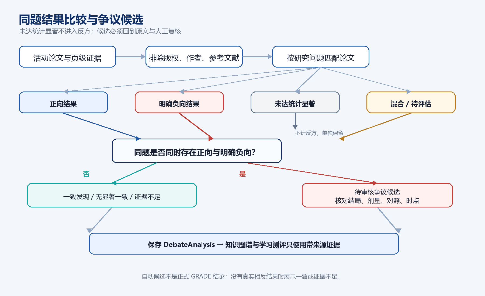

## 4.6 学术共识、分歧与研究空白综合

系统将每条证据归一为论文级结果，并分别保存正向、负向、未达统计显著、混合和待评估集合。争议候选要求同题出现正向与明确负向；显著性、效应方向和可比性不能被合并成一个“正负词”判断。证据确定性参考研究设计、结果一致性、全文覆盖率、样本量和可提取信息，但只是自动化初筛，不等同正式 GRADE 专家评价。研究空白以“当前论文库覆盖不足”表述，不把局部库缺失直接写成整个领域空白。

## 4.7 五层知识图谱构建与可视化

知识图谱由 `knowledge-map-v5` 构建。本轮真实统计为 138 个节点、1,220 条有来源关系、0 个重复节点、0 条重复边。节点层级为：

| 层级 | 节点数量 | 内容 |
| --- | ---: | --- |
| 第一层 | 1 | 青少年体质健康与体育锻炼干预研究 |
| 第二层 | 6 | 核心研究主题 |
| 第三层 | 82 | 44 个研究方向、2 个待细分方向、36 个变量 |
| 第四层 | 42 | 范围内论文证据节点 |
| 第五层 | 7 | 2 个共识、1 个“尚未识别争议”占位、4 个研究空白 |

关系类型包括层级关系 662 条、问题-变量 119 条、论文-变量 261 条、变量研究关系 108 条、综合关系 19 条和论文-综合证据关系 51 条。关系状态为证据不足 57 条、正向关联 24 条、负向关联 7 条、无显著关联 3 条、研究结果不一致 7 条、条件性关系 10 条。第五层的“学术争议”节点是明确显示“尚未识别出可验证相反结论”的占位节点，不是已确认争议。该图表示主题、变量、论文和研究关系，不等同于赛事所指的论文引用网络。

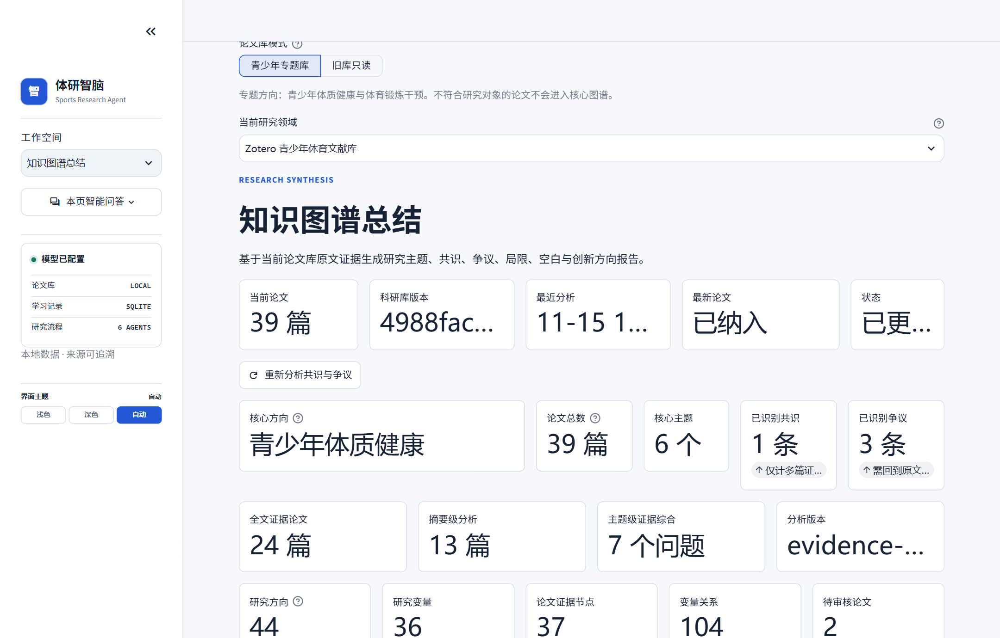

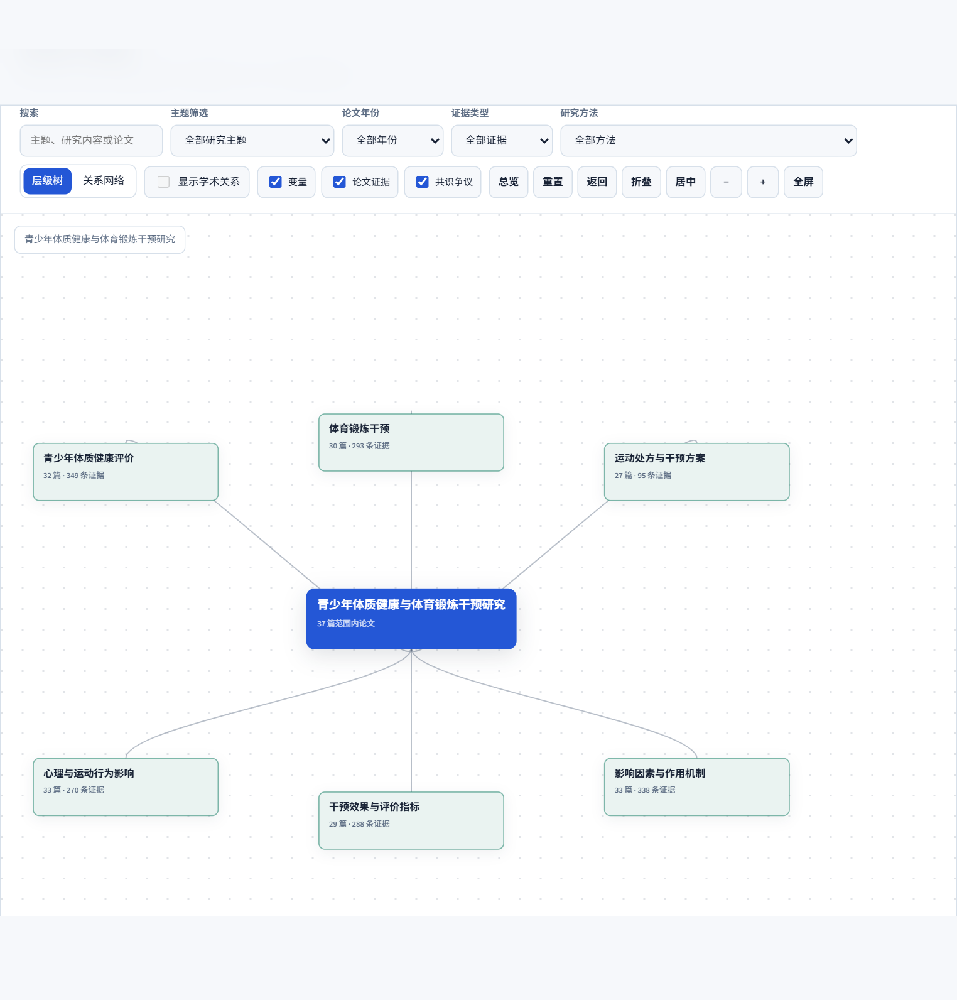

## 4.8 AI 学习测评：五模块、九种注册题型与五维评分

LearningAssessmentAgent 已实现五个模块：基础知识理解、文献深度理解、文献对比分析、学术思辨训练、个性化错题与补学。每道题必须关联活动论文、原文证据和评分细则。文献对比题选择两篇具有方法和结果证据的论文，可引用 14 条证据比较对象、样本、方法、干预、测量、结果、统计线索和结论边界。

| 学习模块 | 五模块预置题型 | 评分方式 |
| --- | --- | --- |
| 基础知识理解 | 单项选择题、多项选择题、判断题、简答题 | 客观题标准答案；简答题五维细则 |
| 文献深度理解 | 深度理解题 | 五维细则 |
| 文献对比分析 | 文献对比分析题 | 五维细则 |
| 学术思辨训练 | 学术思辨题 | 五维细则 |
| 个性化错题与补学 | 个性化补学题 | 五维细则 |

`QUESTION_TYPES` 实际注册 9 种题型，除表中 8 种五模块预置题型外，还保留“论述题”。论述题由 `_essay_question()` 实现，并可通过显式题型调用或学习成长报告的复习路径生成，但没有放入五模块的自动预置任务表。因此，“5 个学习模块”“9 种注册题型”“8 种五模块预置题型”和“5 维评分标准”是四个不同概念，不把五模块改写为六模块。

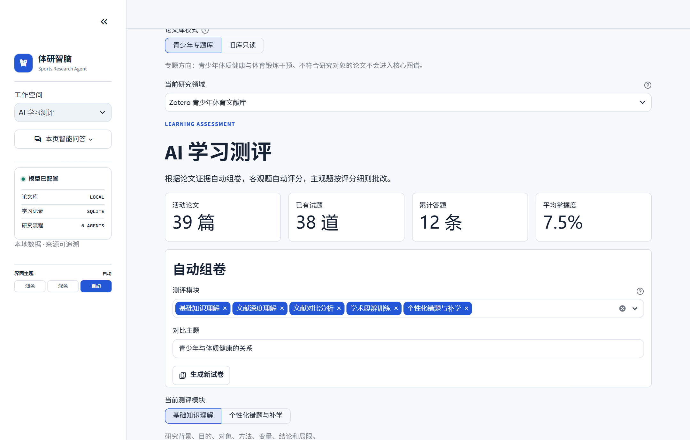

**输入与输出：** 输入为当前领域论文、结构化阅读、证据、错题标签和已测练习表现；输出为持久化的 AssessmentQuestion。

**关键代码：** `LearningAssessmentAgent.generate_question_set()`、`_comparison_question()`、`_deep_understanding()`、`_academic_critical_thinking()`、`_personalized_review()`。

**异常处理：** 空库、未解析库、证据不足、非法模块、数据库写入失败均转换为带代码、原因和建议的 AssessmentGenerationError。缺失 `interventions` 等非必需字段不会导致页面崩溃。

## 4.9 自动评分与错题分析

客观题使用标准答案自动判分。主观题五维总分 14 分：核心观点准确性 4 分、文献证据引用能力 3 分、多篇论文对比能力 2 分、学术逻辑与推理能力 3 分、批判性思维能力 2 分。大模型评分提示明确要求区分原文事实、合理推断和无证据观点，并返回引用证据、无证据主张及事实/推断边界。模型调用失败、超时或 JSON 格式错误时，系统显示失败原因并降级到本地细则。

本地细则综合原文文本重合、DOI/页码/论文题名引用、多论文比较标记、逻辑连接和批判性边界，不因答案篇幅长而自动加分。一次真实文献对比题测试中，带原文和页码的标准答案得到 12.2/14，重复 300 次但没有证据的长答案得到 0/14。

## 4.10 个性化学习反馈与成长报告

每道题的得分会写入 AttemptRecord。PersonalTutorAgent 从历史答题按维度计算得分率平均值，形成概念记忆、文献理解、对比分析、批判性思维和学术应用五维“练习表现”。没有记录的维度显示“未测”，不参与薄弱项判断；该指标尚未经过能力量表校准，因此不把它写成已验证的科研能力等级。错题标签继续用于匹配论文和下一轮练习。

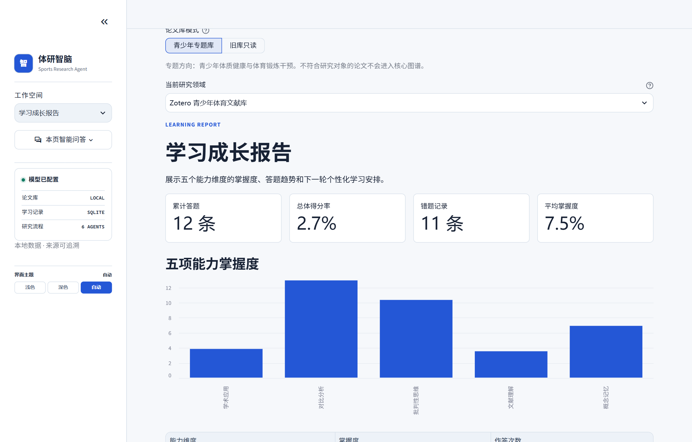

<!-- CONTINUE -->

# 第五章 项目创新点与关键技术

## 5.1 从单篇摘要到同题多文证据综合

传统方法常把多篇摘要放在同一提示词中，由模型自由综合。本项目先按 7 个研究问题匹配论文，再保存论文级方向、显著性提示和来源证据，只有同一问题内出现正向与明确负向结果时才生成待审核候选。技术上通过 QuestionSynthesis、ResearchConflict、negative/null/mixed 论文集合和版本指纹实现。当前 44 篇活动论文重算后得到 2 个初步共识、5 个无显著一致、0 个自动争议候选；未达统计显著不再被错误归入反方。局限是方向判断仍依赖可提取片段和规则，不能替代人工偏倚风险评价。

## 5.2 基于页级证据的可追溯机制

EvidenceRef 同时保存论文 ID、题名、文件名、页码、原文、段落提示和来源类型。RAG、阅读、争议、图谱和测评复用同一证据模型。传统全文搜索只给相似段落，本项目可以显示“哪篇论文、第几页、是全文还是摘要”。局限是复杂排版、表格和公式可能提取不完整。

## 5.3 面向体育教育专题的事实源分层

系统将公开题录、用户 PDF、页级 JSON、SQLite 研究状态和 Chroma 派生向量分层。Chroma 可重建，不能反向生成事实证据；Zotero 与旧库使用独立路径；专题相关度预检阻止无关大学生论文进入青少年核心主题。技术上通过独立数据库、路径隔离、文件哈希和论文库指纹实现。当前边界是本地单用户。

## 5.4 知识综合与科研知识图谱结合

知识图谱不是静态思维导图。第二层主题由真实论文动态匹配，第三层问题与变量来自结构化字段和分类词表，第四层连接论文证据，第五层连接共识、占位争议提示和空白。本轮实际为 138 个节点和 1,220 条关系，所有边保留来源；108 条变量研究关系中有 57 条明确标为证据不足。该图只用于研究结构探索，不表示论文引用关系，也不替代真实引文网络。局限是变量识别仍使用规则和文本共现线索。

## 5.5 测评、错题与练习表现闭环

传统题库与文献库分离，题目更新依赖人工。本项目从当前有效论文自动组卷，删除论文后相关试题失效；评分记录更新五维练习表现，错题标签再进入下一轮个性化补学题。技术上通过题目证据约束、AttemptRecord、MasteryRecord 和版本过滤实现。已测维度使用实际得分率平均值，未测维度显示“未测”；由于尚无能力量表校准，本模块作为扩展功能，不替代科研主流程。局限是本地评分是可解释降级方案，高价值主观题仍建议教师复核。

## 5.6 架构选择与工程取舍

| 方案 | 优点 | 风险 | 本项目选择 |
| --- | --- | --- | --- |
| 单次大模型直接生成 | 实现简单、演示快 | 难以阻止幻觉，难以定位数据错误 | 只用于受限证据问答和评分 |
| 多个模型自由协商 | 理论灵活 | 状态不稳定、成本和复现难度高 | 不宣称采用 |
| 单一大模型加工具调用 | 可选择真实检索工具 | 模型可能不返回调用或参数错误 | LiteratureResearchAgent 采用 |
| 固定顺序科研流水线 | 可检查、可测试、易恢复 | 不能自动探索任意任务图 | ResearchMindWorkflow 采用 |
| 规则与模型混合 | 可在线能力与离线能力之间降级 | 规则结果需要明确标注 | PDF 阅读、争议和本地评分采用 |

该取舍不是追求“Agent 数量”，而是把模型放在真正需要语义决策的位置，把事实证据、去重、版本状态和删除操作交给确定性代码。这样更便于复现实验、显示失败原因并避免让模型修改关键科研数据。

## 5.7 可信性边界与失败策略

系统的可信性来自“事实源不被模型覆盖”。公开题录必须保留来源字段；论文正文必须先形成页级证据；摘要级分析必须显示证据来源；争议必须限定在同一研究问题；模型评分只能读取题目证据和评分细则。论文删除、元数据修改或分析引擎升级后，SHA-256 指纹变化会让旧结果失效，旧结论不会被当前页面继续展示。

| 失败场景 | 当前响应 | 项目不声称的能力 |
| --- | --- | --- |
| 外部学术接口不可用 | 回退可用来源或停止生成综述 | 不保证所有外部服务始终在线 |
| 没有全文 | 使用可核验摘要并明确标注 | 不把摘要当作全文 |
| 没有证据命中 | 返回证据不足 | 不让模型凭常识补写 |
| 结果方向无法判定 | 归入 inconclusive | 不为了形成争议而强行分类 |
| 模型评分格式错误 | 降级到本地细则并显示原因 | 不把降级分数冒充模型评分 |
| 向量索引损坏 | 隔离派生索引并从原文重建 | 不删除原始 PDF 与页码证据 |
| 论文被删除 | 清理关联题目并使分析失效 | 不让旧题目继续引用已删论文 |

因此，本项目适合作为“可追溯的科研辅助与教学工具”，而不是自动替代专家完成系统综述、偏倚风险评价或临床/运动处方决策。

<!-- CONTINUE -->

# 第六章 系统测试与结果分析

## 6.1 测试环境

| 项目 | 实际环境 |
| --- | --- |
| 操作系统 | Windows 11，10.0.26200 |
| Python | 3.12.16，MSC 64-bit |
| Streamlit | 1.66.1 |
| Pandas | 2.3.3 |
| PyMuPDF | 1.28.2 |
| Chroma | 1.5.9 |
| Matplotlib | 3.11.2 |
| 浏览器 | Microsoft Edge 无头模式 |
| 正式领域 | `domain-510b94048a4c` |

## 6.2 自动化回归

2026-11-16 在 ASCII 临时目录执行完整测试：

`181 passed, 7 warnings in 40.95s`，退出码 0；逐项原始输出与 JUnit XML 已保存到 `evidence/tests/pytest-v5-verbose.txt` 和 `pytest-v5-results.xml`。

关键原始输出片段可直接与保存文件核对：

```text
collected 181 items
...
181 passed, 7 warnings in 40.95s
PYTEST_EXIT_CODE=0
```

7 个警告来自 Streamlit 对 NumPy `timedelta` 的弃用提示，不影响当前功能。测试覆盖配置、规划、PDF、清单、BM25、Chroma、Function Calling、回退、用户 PDF RAG、专题库隔离、备份恢复、回收站、证据综合、五层图谱、五模块测评、新练习表现口径、页面加载和安全审计。181 项通过只证明测试集执行成功，不证明体育科研判断正确；OCR、500 页以上真实 PDF、541 页赛事样例、Zotero Web 写入、外部服务长期稳定性和独立专家一致性评价均未覆盖。

**测试结果的使用边界**

- “通过”表示给定测试断言成立，不表示真实论文结论已经由专家确认。
- 页面级 AppTest 能发现异常、状态错位和字段兼容问题，不能替代浏览器交互和外部网络稳定性测试。
- 引用编号属于输入上下文，与“原文支持该论断”仍是两个不同检查。
- 当前证据确定性只是自动化初筛，不替代正式 GRADE、偏倚风险量表和人工复核。

## 6.3 真实功能与异常测试

| 编号 | 测试项 | 测试数据/方法 | 预期结果 | 实际结果 | 结论 |
| --- | --- | --- | --- | --- | --- |
| T1 | 文献检索 | 2021-2026 青少年运动与体质，自动来源 | 返回真实元数据或明确回退 | OpenAlex 返回 HTTP 429，Crossref 回退返回 2 篇 | 通过 |
| T2 | PDF 导入 | 真实论文 PDF、损坏件、空件 | 有效件入库，坏件提示 | 自动化测试与真实库均通过 | 通过 |
| T3 | 文献解析 | 44 篇活动论文 | 区分全文、摘要、题录 | 25 篇全文、16 篇摘要、3 篇仅题录；44 篇均有结构化分析记录 | 通过（数据状态检查） |
| T4 | 原文溯源 | 本地多篇真实论文问答 | 返回文件与页码 | 多篇论文页级引用测试通过 | 通过 |
| T5 | 学术争议 | 7 个研究问题 | 只形成同题候选 | `v5` 重算为 2 个初步共识、5 个无显著一致、0 个自动争议候选 | 流程通过；科研判断待教师复核 |
| T6 | 图谱更新 | 临时库新增与删除论文 | 节点和关系随真实数据变化 | 自动化临时库通过；未在 44 篇正式库直接增删 | 部分通过 |
| T7 | 测评生成 | 五模块真实库 | 五模块均有来源 | 8 道题，知识 4、其余各 1 | 通过 |
| T8 | 自动评分 | 证据答案与长无证据答案 | 证据答案显著更高 | 12.2/14 对 0/14 | 通过 |
| T9 | 异常输入 | 空库、空题、损坏 PDF、无 Key | 明确错误或降级 | 分类提示，无模拟数据替代 | 通过 |
| T10 | 删除与持久化 | 软删除、恢复、永久删除 | 失效、恢复、备份 | 自动化测试通过，重启后状态保持 | 通过 |

## 6.4 赛事指定场景核验

| 场景 | 当前实现与测试 | 结论 |
| --- | --- | --- |
| Attention Is All You Need v1/v7 | 从 arXiv 官方 API 读取两版本，题名均规范化 `attentionisallyouneed` | 去重规则层通过；未宣称已完成 Zotero 端到端导入 |
| 扫描版 PDF OCR | 系统检测“无可复制文本”，但未集成 OCR | 未实现，不能标记通过 |
| 500 页以上长文档 | 入库允许较高字符上限，但没有 500 页实测样本 | 未实测，不能标记通过 |
| 单篇原文问答 | EvidenceRAGService 单文件页级检索测试 | 通过 |
| 多篇原文问答 | 两篇真实论文均返回页级证据 | 通过 |

## 6.5 正式论文库统计

| 统计口径 | 论文数 | 页级证据 | 当前含义与来源 |
| --- | ---: | ---: | --- |
| 正式专题领域 | 44 | 3,296 | `domain-510b94048a4c`；来源为 Zotero 35、Crossref 4、OpenAlex 4、内置清单 1 |
| 全 SQLite 数据库 | 46 | 3,311 | 正式领域 44 篇 + 另一独立领域 2 篇及其中 15 条证据 |
| 参与结构化分析 | 44 | - | 全文 25 篇 + 摘要级 16 篇 + 仅元数据 3 篇 |
| 仅有题录 | 3 | 0 | 没有可核验方法/结果结构，不进入结果方向比较 |
| 知识图谱 | 44 | 3,296 | 核心领域全部活动论文，其中 42 篇进入图谱，2 篇待审核 |

上述数字来自 `export-manifest.json`、论文/证据 CSV 和 `knowledge-graph-statistics.json`，并由 `test-evidence-v5.json` 交叉汇总。旧文档的 39 篇、3,281 条、133 节点和 1,176 关系是本轮之前的数据库快照，不再作为当前运行口径。138 个节点和 1,220 条关系只描述当前正式专题领域的 `knowledge-map-v5` 图谱，不包含另一领域 2 篇论文；其中大量边是主题、方向和论文归属关系，不能解释为论文引用次数。

## 6.6 与赛事评分维度的对应证据

| 评分维度 | 文档与系统证据 |
| --- | --- |
| Agent 与大模型技术深度 35% | Function Calling、证据约束 RAG、多文同题综合、五维主观题评分、任务状态与失败回退 |
| 科研场景创新性 25% | 同题争议而非全库拼凑、五层证据图谱、学习测评与科研分析共享论文库 |
| 全栈工程质量与鲁棒性 10% | 当前源码 181 项测试、最终导出副本复测、SQLite/JSON/Chroma 分层、指纹失效、备份恢复、安全审计 |
| 科研实用性与业务闭环 10% | Zotero 同步、真实专题库、页级证据追问、同题结果比较；测评作为扩展功能 |
| 学术级 UI/UX 与交互体验 10% | 21 个页面、模块切换、证据展开、图谱筛选与详情、成长趋势 |
| 学术价值与应用广度 10% | 青少年体质健康专题、可追溯原文、研究空白与后续方向，不伪造数据 |

## 6.7 原始测试输出与可核验导出

完整测试不只保留结论数字，还保存了逐项测试名称、PASSED 标记、警告、退出码和 JUnit XML：

| 证据文件 | 内容 | 实际结果 |
| --- | --- | --- |
| `evidence/tests/pytest-v5-verbose.txt` | `pytest -vv` 原始控制台输出 | 181 items，全部 PASSED，退出码 0 |
| `evidence/tests/pytest-v5-results.xml` | JUnit XML | 181 tests、0 failures、0 errors、0 skipped |
| `evidence/exports/papers-44.csv` | 正式领域论文 | 44 行 |
| `evidence/exports/papers-46-all-database.csv` | 全库论文 | 46 行 |
| `evidence/exports/evidence-3296-core-domain.csv` | 正式领域证据 | 3,296 行 |
| `evidence/exports/evidence-3311-all-database.csv` | 全库证据 | 3,311 行 |
| `evidence/exports/knowledge-graph-nodes.csv` | 图谱节点 | 138 行 |
| `evidence/exports/knowledge-graph-edges.csv` | 图谱关系 | 1,220 行 |
| `evidence/exports/knowledge-graph-statistics.json` | 图谱统计 | 节点、关系、层级、关系状态 |
| `evidence/exports/export-manifest.json` | 导出审计 | 数据库和所有 CSV/JSON 的 SHA-256 |
| `evidence/test-evidence-v5.json` | 本轮统计总汇 | 绑定 JUnit、导出清单、数据库与限制说明 |

页级证据 CSV 保存论文 ID、文件名、页码、段落提示、原文长度、原文 SHA-256 和 160 字预览，公开包不批量分发受版权保护的完整正文。`manifest` 同时记录 3,296 条主领域证据和 3,311 条全库证据，避免把两个统计口径混用。技术文档中的 181 项测试来自当前源码；最终导出副本会在自身根目录再次执行并生成 `SUBMISSION_ACCEPTANCE.json`，不能用原工作区结果代替导出包结果。

## 6.8 普通大模型与体研智脑争议分析对照实验

历史实验使用 `deepseek-flash`，对 7 个研究问题各调用一次并全部成功。普通模型与项目使用保存的代表证据子集，但两者没有独立专家金标准，且项目后续代码已从 `evidence-synthesis-v4` 升级到 `v5`。本轮没有重新调用模型，而是保留原始回答，按新口径离线复核；因此不能把 5/7 或 4/7 写成准确率。

| 研究问题 | 论文数 | 证据数 | 普通模型原始判断 | v5 规则复核 | 体研智脑 v5 |
| --- | ---: | ---: | --- | --- | --- |
| 体育锻炼与心肺耐力 | 3 | 3 | 有争议，B 方为无显著 | 无显著不计反方 | 一致未观察到显著差异 |
| 体育锻炼与身体成分 | 6 | 6 | 有争议，A/B 指向同一论文 | 同一论文内部比较不构成跨论文争议 | 初步共识 |
| 体育锻炼与肌肉力量 | 5 | 5 | 无争议 | 无争议 | 一致未观察到显著差异 |
| 体育锻炼与身体素质 | 3 | 3 | 无争议 | 无争议 | 一致未观察到显著差异 |
| 体育锻炼与心理健康 | 3 | 3 | 有争议，B 方为无显著 | 无显著不计反方 | 一致未观察到显著差异 |
| 运动频率与健康效果 | 3 | 3 | 无争议 | 无争议 | 初步共识 |
| 运动强度与健康效果 | 3 | 3 | 无争议 | 无争议 | 一致未观察到显著差异 |

普通模型原始声称 3 个争议；按“不同论文、正向对明确负向”的 `v5` 口径复核后为 0 个。体研智脑当前自动候选也为 0，因此在“是否形成争议”的二分类上为 7/7 一致。这只是与当前规则的一致性，不是准确率，也不证明项目优于普通模型。实验为 `n=1` 工程对照，7 个问题均未经体育科研教师独立复核；空白复判字段已保留在 `manual-review-template.csv`。

引用核验分两层。第一层检查 9 个证据编号和 7 个论文 ID 是否属于保存的输入上下文，本轮为 0 个无效编号；7 题共 26 条输入证据已按 SHA-256 或唯一预览从本地授权证据库恢复全文。第二层检查“原文是否支持模型论断”，目前尚未完成逐论断人工判断，`claim_support_verified=false`，7 个问题均标记“待人工复核”。引用编号存在不能被写成原文支持结论。

本轮保留一个关键错误发现：普通模型在“身体成分”题中把同一篇论文内部的既往研究比较拆成 A/B 两方，制造了跨论文争议的外观。该发现说明“编号存在”与“论文级观点组织正确”是不同检查，也说明单次提示仍需要确定性规则和人工科研复核。

<!-- CONTINUE -->

# 第七章 部署、异常处理与安全机制

## 7.1 Windows 本地部署

推荐使用 Python 3.11 或 3.12。项目的实际验收环境为 Python 3.12.16、Windows 11。安装和启动命令如下：

```powershell
cd "<解压后的项目根目录>"
py -3.12 -m venv .venv
.\.venv\Scripts\python.exe -m pip install -r requirements.txt
Copy-Item .env.example .env
.\.venv\Scripts\python.exe -m streamlit run app.py
```

默认地址为 `http://localhost:8501`。最终导出包把 README、`app.py`、依赖、测试、文档和公开测试语料放在同一根目录；安装与启动不使用原作者的绝对盘符。导出副本可执行 `python tools/run_submission_acceptance.py`，再运行 `python tools/refresh_submission_manifest.py` 生成绑定代码哈希的验收记录。

## 7.2 配置与环境变量

| 变量 | 用途 | 默认/约束 |
| --- | --- | --- |
| `OPENAI_API_KEY` | OpenAI 兼容模型接口 | 空值进入明确模拟或规则模式 |
| `OPENAI_BASE_URL` | Chat Completions 基础地址 | 程序自动追加路径 |
| `OPENAI_MODEL` | 模型名称 | 由服务商决定 |
| `MAX_PDF_PAGES` | 单次阅读页数上限 | 80 |
| `MAX_PDF_CHARS` | 单次阅读字符上限 | 40,000 |
| `RAG_CHUNK_CHARS` | 页内片段目标长度 | 700 |
| `RAG_CHUNK_OVERLAP` | 片段重叠 | 120 |
| `RAG_RETRIEVAL_MODE` | hybrid/semantic/bm25 | hybrid |
| `RESEARCHMIND_DATE_FROM` | 默认检索起始日 | 2023-01-01 |
| `ZOTERO_API_KEY` | Zotero Web API | 可选；不得写入代码 |
| `ZOTERO_LIBRARY_ID` | 用户或群组库 ID | 可选 |

Zotero Desktop Local API 使用 `http://127.0.0.1:23119/api/users/0`。如果无法访问，应确认 Zotero 正在运行、Local API 已启用、端口未被占用。系统不会把 Zotero DB 复制进项目，也不会覆盖 Zotero 已有数据。

## 7.3 异常处理矩阵

异常处理遵循“保留事实源、隔离失败、明确降级”的原则。网络失败不回滚已入库论文，解析失败不写入伪造证据，模型失败不回退成无来源结论；数据库操作失败时，系统返回具体失败阶段并保留原始文件。矩阵中的“恢复”表示用户可执行的下一步，不表示系统已经自动修复所有外部服务。

| 触发条件 | 检测方式 | 系统响应 | 用户提示/恢复 |
| --- | --- | --- | --- |
| 外部检索超时 | HTTP/超时异常 | 回退 Crossref、arXiv 或返回空结果 | 显示来源失败原因 |
| API Key 缺失 | 配置属性为空 | 规则模式或明确失败 | 提示配置 `.env` |
| 模型返回非 JSON | JSON 解析校验 | 主观题回退本地细则 | 显示失败类型与原因 |
| PDF 损坏 | PyMuPDF 异常 | 拒绝导入 | 建议重新下载 |
| PDF 加密 | `needs_pass` | 拒绝提取 | 提示解除密码 |
| 扫描版无文本 | 提取结果为空 | 标记可能为扫描版 | 提示 OCR 或可复制文本 |
| 检索结果为空 | 候选列表为空 | 不生成综述和引用 | 调整关键词或时间范围 |
| 原文证据不足 | 检索无命中 | 不调用模型补写 | 显示证据不足 |
| 文献方向未判定 | 规则判定失败 | 不计入共识或争议 | 保留“方向未判定” |
| 图谱布局失败 | 组件错误捕获 | 回退节点与关系表 | 提示组件不可用 |
| 组卷证据不足 | AssessmentGenerationError | 跳过对应题型 | 显示缺失题型和字段 |
| 数据库读写失败 | SQLite 异常 | 回滚并包装错误 | 检查权限、磁盘和连接 |
| 论文库变化 | 指纹不一致 | 旧分析冻结、后台重算 | 显示待更新状态 |
| 向量库损坏 | HNSW 错误识别 | 隔离旧索引并重建 | 保留原 PDF 与 JSON |
| 删除误操作 | 软删除与回收站 | 保留论文和 PDF | 可恢复；永久删除需确认 |

## 7.4 安全与隐私

API Key 只从 `.env` 或环境变量读取，`.env.example` 只保留空值。数据库、用户 PDF、题库、学习记录、浏览器资料和日志不进入公开导出。安全审计工具可以阻断 `.env`、数据库、日志、私钥和敏感文件名，并对 PDF、Chroma 和论文正文提示人工版权复核。

当前系统没有账号、租户隔离、请求限流和操作审计后台，因此不应直接作为公网多用户服务。正式演示应使用脱敏论文库，关闭个人学习记录导出，并在网络评审环境重新验证外部 API。

## 7.5 Agent 调度、模型调用与失败回退证据

知识图谱页面展示最近一次派生分析调度摘要：当前论文 44 篇、论文库指纹 `cf4ba5bcf60a`、最新论文已纳入和状态“已更新”。对应 `scheduler-status.json` 记录 `is_current=true`、已分析 44 篇且无错误。需要说明，当前程序持久化最近调度状态，不保存完整历史事件流浏览器，因此不把“状态摘要”冒充逐事件日志。

| 调度字段 | 当前含义 |
| --- | --- |
| 论文库版本 | 当前数据源与 `evidence-synthesis-v5` 生成的组合指纹 |
| 最新论文已纳入 | 活动论文 ID 集合与最近分析范围一致 |
| 最近一次分析 | 保存完成时间和成功/失败状态，供页面判断是否过期 |
| 完整历史事件日志 | 当前未实现，不能用一张状态截图替代任务追踪系统 |

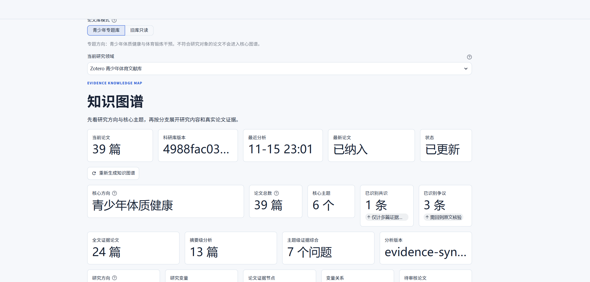

智能文献研究页执行真实研究问题后，Agent 优化检索式并调用 `semantic_scholar_search` 工具。本次模型调用由 `deepseek-flash` 发起，Semantic Scholar 无匹配后回退 arXiv，最终取得 4 条真实元数据；页面显示 Function Calling 流程进入后续规则整理，属于同一次运行中的降级组合。截图未显示 API Key 或 Authorization 头。

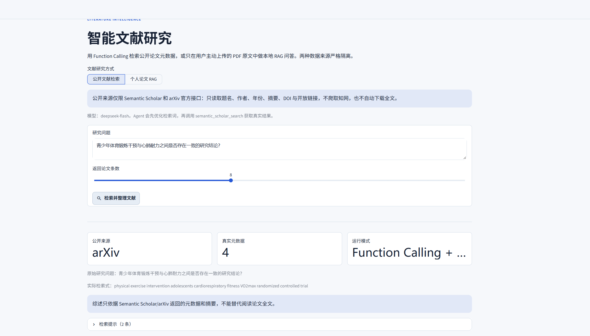

故障验证使用独立 8503 实例，把模型地址临时指向不可达的本地端点并设置 3 秒超时，不修改正式 `.env`。页面明确显示“Function Calling 未完成，已切换到规则检索模式”、连接失败原因、Semantic Scholar 限流提示和 arXiv 空结果；系统没有伪造模型综述或引用。

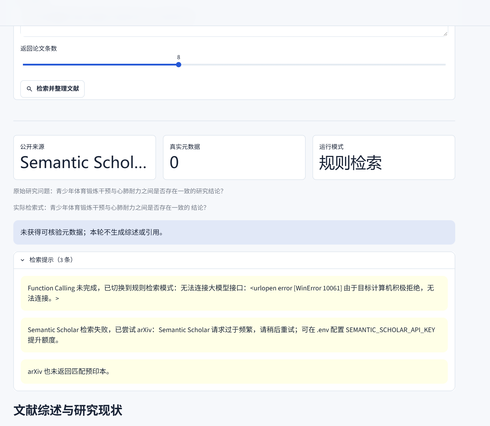

## 7.6 运行证据的解释边界

三张截图分别证明当前实例的调度摘要、一次成功 Function Calling 调用和一次受控故障回退，不代表所有网络条件或所有模型都能得到相同结果。调度页当前显示最近任务状态，不保存完整历史事件流；模型调用页证明工具选择与公开检索链路已经接通，不等于 Semantic Scholar 或 arXiv 始终可用；故障页使用独立 8503 实例和不可达端点验证降级逻辑，没有修改正式 `.env`。

运行截图仅用于证明代码路径和用户提示，没有展示 API Key、Authorization 头或账户信息。完整请求上下文、模型原始回答和逐题对照结果保存在 `evidence/controversy-comparison/`；调度状态、页面浏览器错误和回退原因分别保存在 `scheduler-status.json`、`model-call-capture.json` 和 `failure-fallback-capture.json`。

<!-- CONTINUE -->

# 第八章 总结与展望

## 8.1 完成情况

项目已经形成一条可运行的体育科研辅助链路：真实题录采集、Zotero 本地读取、PDF 页级证据、混合检索、原文问答、结构化阅读、同题结果比较、五层研究关系图、五模块测评和练习反馈。当前正式领域 44 篇论文、3,296 条证据，全库 46 篇论文、3,311 条证据，正式领域研究关系图为 138 个节点、1,220 条关系。完整自动化测试 181 项通过，原始输出已归档；最终导出副本的根目录启动与复测结果另由 `SUBMISSION_ACCEPTANCE.json` 绑定代码哈希。

## 8.2 客观价值

项目对体育教育科研训练的价值主要体现在证据意识和流程透明度。用户可以看到论文是否有全文、结论来自全文还是摘要、学术争议是否真的存在于同一研究问题、题目引用了哪篇论文以及错题为何扣分。与直接生成综述相比，这种方式更适合教学、复核和竞赛展示。

## 8.3 现存不足

| 类别 | 尚未完成或仍有风险 |
| --- | --- |
| OCR | 未集成；扫描版 PDF 无法建立文字索引 |
| 超长文档 | 代码路径支持较高字符上限，但未完成 500 页以上真实测试 |
| 自动争议 | 依赖规则方向和可提取片段，不是正式系统综述或 GRADE |
| 科研判断 | 当前 7 题均为待审核；没有专家金标准，不能把与规则一致写成准确率 |
| 引文网络 | 当前 1,220 条边主要是主题、方向、变量和论文归属关系，不是论文引用网络 |
| 模型质量 | 依赖兼容接口稳定性、模型能力与输出格式 |
| 多用户 | 无账号、权限、租户和请求隔离 |
| Zotero 写入 | Web API 代码存在，但当前运行验收以 Local API 读取为主 |
| 全文覆盖 | 3 篇论文仅有题录；研究关系图另有 2 篇范围外/待审核论文，未强行生成结论 |
| 表格公式 | PyMuPDF 对复杂表格、公式和双栏排版提取可能不完整 |
| 任务追踪 | 仅保存最近一次分析调度摘要，不提供完整历史事件流或独立任务审计后台 |

## 8.4 后续方向

后续可增加 OCR 和版面分析，保留表格与公式位置；增加跨版本论文去重与变更记录；把方向、变量与关系物化为派生表以支持更大论文库；增加正式 GRADE 所需的偏倚风险量表和人工复核流程；将当前单机 SQLite 替换为受控服务数据库，并增加账号、审计、任务队列和限流；最后，在真实评审网络重新验证 Semantic Scholar、OpenAlex、Zotero 和模型接口的可用性。

<!-- CONTINUE -->

# 参考资料

1. Streamlit Documentation. https://docs.streamlit.io
2. PyMuPDF Documentation. https://pymupdf.readthedocs.io
3. Chroma Documentation. https://docs.trychroma.com
4. OpenAI Chat Completions API Reference. https://platform.openai.com/docs/api-reference/chat
5. OpenAlex API Documentation. https://docs.openalex.org
6. Crossref REST API Documentation. https://www.crossref.org/documentation/retrieve-metadata/rest-api/
7. Semantic Scholar Academic Graph API. https://api.semanticscholar.org
8. arXiv API Documentation. https://info.arxiv.org/help/api
9. Zotero Local API Documentation. https://www.zotero.org/support/dev/web_api/v3/local_api
10. 项目代码与测试：`app.py`、`researchmind/`、`services/`、`tools/`、`tests/`。
11. He J, Bi X, Yao J, Wang K, Zhou J. Physical education-embedded fitness-oriented exercise interventions for youth physical fitness: a systematic review and meta-analysis. BMC Public Health. 2026. DOI: 10.1186/s12889-026-28404-y.
12. Wu J, Yang Y, Yu H, Li L, Chen Y, Sun Y. Comparative effectiveness of school-based exercise interventions on physical fitness in children and adolescents: a systematic review and network meta-analysis. Frontiers in Public Health. 2023. DOI: 10.3389/fpubh.2023.1194779.
13. Bengtsson D, Svensson J, Wiman V, Stenling A, Lundkvist E, Ivarsson A. Health-related outcomes of youth sport participation: a systematic review and meta-analysis. International Journal of Behavioral Nutrition and Physical Activity. 2025. DOI: 10.1186/s12966-025-01792-x.
14. Meng C, Yucheng T, Shu L, Yu Z. Effects of school-based high-intensity interval training on body composition, cardiorespiratory fitness and cardiometabolic markers in adolescent boys with obesity: a randomized controlled trial. BMC Pediatrics. 2022. DOI: 10.1186/s12887-021-03079-z.
15. Singh B, Bennett H, Miatke A, Dumuid D, Curtis R, Ferguson T, et al. Systematic Umbrella Review and Meta-Meta-Analysis: Effectiveness of Physical Activity in Improving Depression and Anxiety in Children and Adolescents. Journal of the American Academy of Child and Adolescent Psychiatry. 2026. DOI: 10.1016/j.jaac.2025.04.007.
16. Page MJ, McKenzie JE, Bossuyt PM, Boutron I, Hoffmann TC, Mulrow CD, et al. The PRISMA 2020 statement: an updated guideline for reporting systematic reviews. BMJ. 2021;372:n71. DOI: 10.1136/bmj.n71.
17. Guyatt GH, Oxman AD, Vist GE, Kunz R, Falck-Ytter Y, Alonso-Coello P, et al. GRADE: an emerging consensus on rating quality of evidence and strength of recommendations. BMJ. 2008;336:924-926. DOI: 10.1136/bmj.39489.470347.AD.

## 附录 A 交付证据索引

| 证据 | 用途 | 路径 |
| --- | --- | --- |
| pytest 文本/JUnit | 核对 181 项测试及警告 | `evidence/tests/pytest-v5-*` |
| 论文/证据 CSV | 核对 44 篇、3,296 条及全库 46 篇、3,311 条 | `evidence/exports/` |
| 图谱节点/关系 | 核对 138 节点与 1,220 条有来源关系 | `evidence/exports/knowledge-graph-*.csv` |
| v5 统计摘要 | 汇总数据库、测试、对照实验与限制 | `evidence/test-evidence-v5.json` |
| 七题对照复核 | 区分规则一致性、准确率和待人工复核 | `evidence/controversy-comparison/REPORT_V5.md` |
| 包内验收 | 记录最终副本测试、启动、代码树哈希 | `SUBMISSION_ACCEPTANCE.json` |
